# Folly Studio — design

What was built, why each decision went the way it did, what it costs, and where it stops. `SPEC.md` is the
contract the code follows; `IDEAS.md` is where it could go next; `docs/HOSTING.md` is how to run it at home.

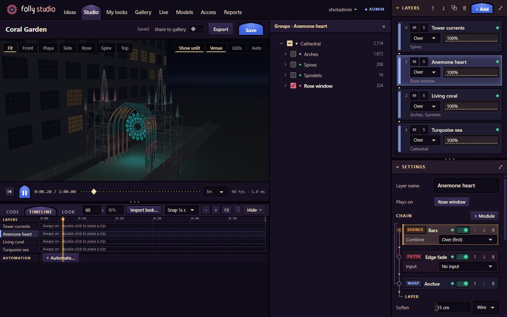

## 1. Product shape

People sign in, describe a show idea in a sentence, and get a **look**: pattern code in layers on groups of the
Gothic Folly's 4,870 LEDs. They preview it live, edit code, sliders, globals and the timeline, save and share it.
A look that should play on the Folly is **baked** to frames in a box on the server, **reviewed** by a curator,
and **exported** as `.fseq`.

```
account → idea → look → live preview → bake → curator review → .fseq export
           (generator)    (phone/laptop)  (render box)  (frames, not code)
```

It is hosted on the owner's computer for tens of people (the camp and friends), behind an HTTPS tunnel.

| Where | What | Why there |
|---|---|---|
| Phone or laptop | The app, the 3D preview, every pattern's code (sandboxed), playback of baked frames | Each viewer pays for their own preview; the server runs no look code |
| The owner's computer | Accounts, JSON store, API, static files, generators, bakes, frame encoding (~100 MB idle) | One cheap process; nothing to operate |
| Render box (bubblewrap) | One bake at a time, nice 10, ≤ 1 GB, a wall clock | The only place look code runs on the server |
| Fleet foundry (opt-in) | Deep ideas in a boxed agent, one at a time | Minutes per idea; off unless asked for |

- **Alternatives.** A desktop app (no shared gallery, no phones), a hosted service (cost and operations for a
  few dozen users), an xLights plugin (desktop-only C++, no AI loop).
- **Trade-off.** The server is a personal machine: its uptime and upload are the service's.
- **The UI.** Preact components in TSX, with signals for state. The look being edited is one signal, replaced
  (never mutated) on each edit; what follows from it (unsaved or saved, the selected layer and module, what the
  sandbox runs) is computed, so no panel keeps another in sync by hand. The imperative parts stay imperative behind
  thin components: the WebGL view, the sandbox runtime, the frames stream. Per frame nothing renders: the clock moves
  the playhead through a ref and the time readout through a signal bound to its text, at most 8 times a second.

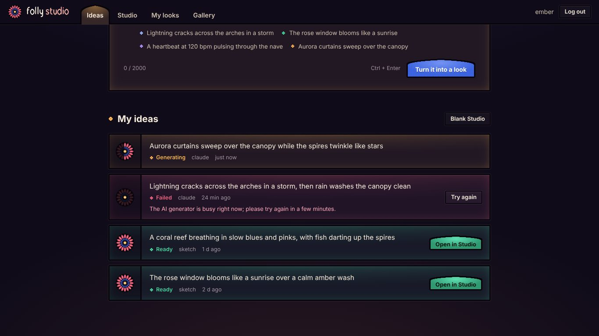

## 2. Dependencies, and light

We use a dependency whenever it makes life easier: TypeScript checks the code and Vite builds the browser's part;
Fastify and its plugins serve the API and the build (routing, bodies, cookies, login limits, static files), and zod
holds the shapes both sides share (`shared/schemas/`: the look, the API's bodies, the generators' output), so the
types come from the rules and the AI's JSON Schema from the same schema the server cleans its answer with. Each is
pinned exactly, the lockfile is committed, CI installs with `npm ci`, and CONTRIBUTING says why each is
there. What has to stay true:

- **It works offline on the playa.** Dependencies are installed at setup, and the browser's bundled at build time;
  nothing is fetched at run time and nothing comes from a CDN. The app, the sandbox and the boxes load only our own
  files.
- **What ships to the browser stays lean.** Phones on the camp's link pay for every byte, so the budgets below are
  measured on the build, and a library earns its place in the browser only within them.
- **The sandbox and the boxes stay closed and small.** The sandbox page carries everything it runs (its CSP loads
  nothing); the boxes run our core from its source and the stdlib, nothing else.
- **No build for the server.** Node runs the server's, the boxes' and the tests' TypeScript as written, stripping
  the types, so what runs is what is in git; only the browser's code is built. The browser takes the shared
  schemas as types only, so zod ships only where a view deliberately validates with one.

| Budget | Limit | Now | Measured by |
|---|---|---|---|
| App JS, CSS and sandbox page, gzipped, as built (Preact and signals: 11 KB of it) | 165 KB | 117.7 KB | `test/build.test.js` |
| Login page path | 40 KB | 26.1 KB | `test/build.test.js` |
| Cold Studio load (13 requests) | 205 KB br / 240 KB gzip | 149.1 / 174.5 KB | `test/transfer.test.js` |
| Reload, a minute or a day later | shell + API, all 304 | 3 requests, 1.6 KB | `test/transfer.test.js` |
| Phone preview, a composed look, 4× CPU slowdown | ≥ 20 fps computed | 30 fps | `npm run perf` |

Built files are named by their content and cached for a year; views and their styles load on first use; lists
carry no code. The code itself is ratcheted: sources ≤ 400 lines, tests ≤ 600, library patterns ≤ 150, and each
area's total lines in `tools/budgets.json` may grow only with a written reason. Over a limit, a module is split
by responsibility.

- **Alternatives.** No dependencies at all, with our own content hashing, import map and stylesheet concatenation
  (no supply chain, but unminified code and machinery to maintain); React (several times Preact's 11 KB with
  signals) or Svelte (a compiler of its own) for the UI; three.js for the 3D view (alone it would fill the budget).
- **Trade-off.** A build before the app is served and a lockfile to keep current. We still maintain our own WebGL,
  the checks oxlint lacks (`tools/budgets.ts`), and the auth design (scrypt hashes that name their
  cost, hashed session tokens, the CSRF rule as a hook): the auth libraries are deprecated, a framework of their own,
  or stateless and so not revocable.

## 3. The pattern model

A pattern is a plain script defining `pixel(p, t, P, G)`, called for every LED every frame and returning a
colour. A stdlib (`noise`, `fbm`, `hsv`, `pal`, `beat`, `centres(tag)`, `use(name)`, …) is in scope. The pixel
`p` gives every way the Folly is interesting to address:

| Fields | Meaning |
|---|---|
| `x y z`, `X Y Z`, `lx ly lz` | Space three ways: 0..1 across the rig, metres, 0..1 across the layer's own pixels ("a pattern fills what it lands on") |
| `a r` | Polar on the façade round the layer's centre: rose spins, spirals, ripples |
| `u i n` | Along the wire: position on its fixture, so chases run up arches and spires |
| `zone fixture ring sector attr() is(tag) seed` | Structure: the rose's rings and petals, tags such as `rose` or `canopy`, a stable random per LED |

- **Why JavaScript.** It is what an AI writes best and what people can read and tweak, and state across frames
  (particles, trails, automata in `frame()`) needs a real language.
- **Alternatives.** A formula language (safe by construction and portable to GLSL, but too small for stateful
  effects); GLSL directly (fast, but state across frames and logic along strands are awkward, and a runaway
  shader stalls a phone's GPU).
- **Trade-off.** It has to be sandboxed (§6) and runs on the CPU (§14). A pure-expression **formula tier** that
  compiles to JS and to GLSL, so a look can feed TouchDesigner, is future work.
- **Determinism.** No `Math.random` in the core, the boxes or the library (lint enforced): `rand`, `hash`,
  `noise` and `seed` are stable, so the same look bakes to the same bytes, and a bake is reused by its key.

## 4. Composition and globals

A layer is a **chain of modules**: warps move the pixel, sources draw, filters rework the colour so far, some
by another source (meteors masked by clouds). Per pixel it is one pass with no intermediate buffers, so it costs
no memory per frame and stays cheap on a phone. 59 library entries (41 sources, 7 warps, 11 filters) fill the
shelves; hovering one (on a phone, Preview) auditions it in the 3D view without saving anything.

**Blur and soften.** The one thing a pixel cannot do alone is read its neighbours, so the core does it natively: the
`blur` filter (radius in metres, along the wire, in space or both, an amount) and each layer's `soften`, a small
blur after its chain. New and generated layers soften by default, 0.15 m along the wire: on an arch (LEDs 0.1 m
apart) a bar's one-LED step becomes a three-LED ramp, and on the spires and canopy (0.5 m) nothing changes. A chain
with a blur runs in stages round it: the modules before it for the layer's every pixel into a buffer made at prepare,
the blur, then the rest per pixel; a chain without one keeps its single pass, byte for byte. Only the layer's own
LEDs count, so the edge of a selection keeps its brightness. The neighbours come from the rig once: a uniform grid of
1.5 m cells for space, each fixture's wire by arc length, every list nearest first so a blur stops at its radius. At
the source, `soft()` and `band()` draw edges that need no blur, and the library's hard-edged sources (bars, single
strand, marquee, curtain, strobe's fade) take a `softness`.

| On the Folly (4,870 LEDs) | Cost |
|---|---|
| Neighbour graph, once per rig (the sandbox's `init`) | 56 neighbours a LED in space, 25 along the wire; 3.2 MB; about 50 ms |
| The perf demo look, a frame (`test/spatial.test.js`) | 3.3 ms; 3.6 ms with the default soften; 4.4 ms with a 1 m blur in space |

| Kind of global | Which | How |
|---|---|---|
| Applied by the runtime | `speed` (an integrated clock, so a change never lurches), `level`, `hue`, `saturation` | Every pattern obeys them, even ones that never read `G` |
| Read by patterns | `energy`, `palette` (roles `low body accent high`, from `td/palettes`), macros (`G.storm`) | Only patterns written to read them respond |

A number param can be **modulated**: an LFO (Hz or beats), a global, or the clip envelope, resolved once per
frame per layer. **Automation lanes** move a global or macro over the look's time, linearly between points.
Palettes come from the same CSVs TouchDesigner uses, so a look and a TD show agree on colour.

- **Alternatives.** Per-layer frame buffers with a node graph (any spatial filter, at a full frame per node per
  layer); blur in pattern code (portable, but slow, and a pattern could not see past its own pixel); hard-coded
  colours (no palettes to swap).
- **Trade-off.** Filters see one pixel at a time: blur is the one spatial operation, and only the core's. No
  layer can read another's output, and a warp before a blur runs again after it, so a warp must be pure.

<p>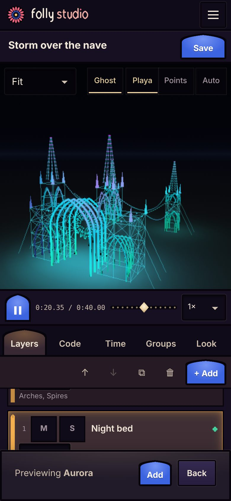
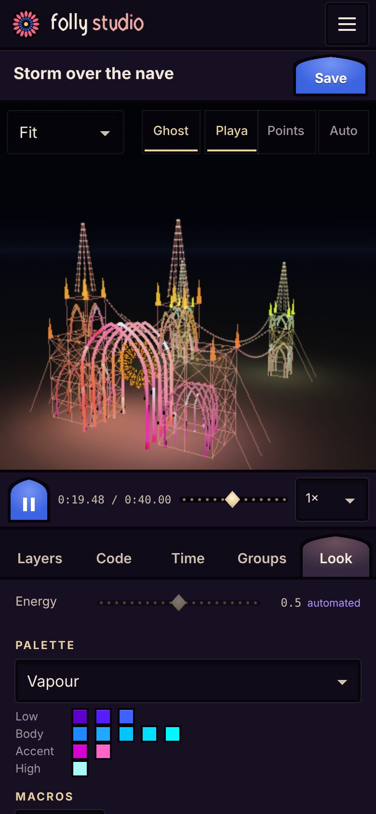</p>

*Phone: auditioning a library source over the whole rig before adding it; the Look tab, with energy automated,
the palette by role and the macros.*

## 5. The timeline

Sequencing lives on the look, xLights-style: a `duration` (1–600 s, loops in preview), optional `bpm`, and clips
on each layer with linear fades. **A clip only scales its layer's level**, and **patterns run on show time**,
so motion carries on across a cut instead of restarting. Sequencing looks means importing another look's layers
and placing clips. This is TouchDesigner's `folly_cues` model: it crossfades levels, not looks; every look keeps
its clock and a cue decides only who is visible.

- **Alternatives.** xLights' effect-local time (each effect starts at 0, so a cut jumps); keyframed params on
  every module (powerful, but a much bigger editor and file).
- **Trade-off.** Clips cannot sequence params: bind a param to a macro and automate that. A layer at envelope 0
  is skipped entirely (no `frame()`), so a stateful pattern's state pauses while it is off.

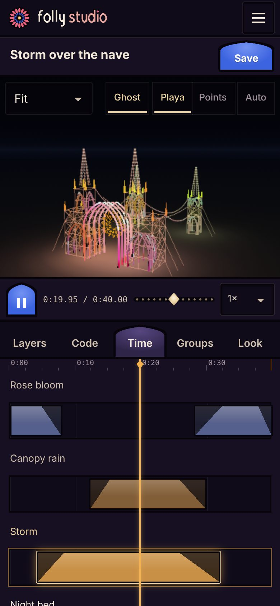

## 6. Trust and safety

**Pattern code is untrusted.** The AI writes it from a stranger's idea, and anyone can paste code. It runs in
exactly two places, and neither can reach accounts, cookies or the network:

| Where | Boundary | If it misbehaves |
|---|---|---|
| Browser | `<iframe sandbox="allow-scripts">` at an opaque origin, CSP `default-src 'none'`, code in a Worker from a Blob | A watchdog: a frame over 1 s or a compile over 0.7 s kills the worker, blames the layer, carries on without it |
| Server | The **render box**: bubblewrap `--unshare-all` (no network), `--clearenv`, read-only inputs, one writable `/out`; prlimits on CPU, tasks, file size and data; nice 10; a wall clock; layers in a stdlib-only `node:vm` realm | Killed; the bake fails. No bubblewrap means 503, never an unboxed fallback |

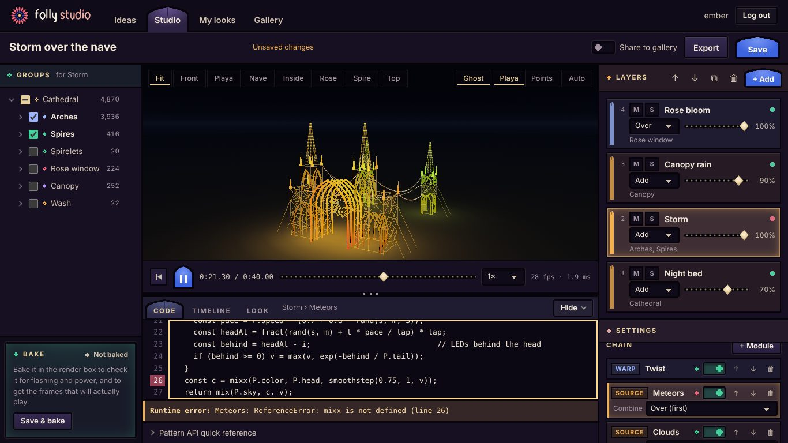

The server's own process never runs look code (lint keeps `eval`, `node:vm` and `child_process` to their
allowlisted files). A Fleet worker's bake is **advisory**: its frames are parsed as data, and what it says about
itself is kept marked untrusted.

**Curators approve baked frames, and those frames are what plays.** Review needs a passing render-box bake of the
look's current layers; any edit clears the bake and the review. A curator judges bytes that cannot change, not
code that might behave differently at showtime.

**Flash checks** adapt WCAG 2.3.1 (general flash: more than 3 flashes in any second) to a sculpture, per region.
Flashing over a large area (the whole rig, a group with ≥ 10 % of the LEDs, or ≥ 10 % of the lit area seen from
the front or side) **blocks review**; flashing confined to small regions such as the spirelets only **warns**, for
the curator to judge. The live preview runs the same rule on the frames it shows and dims a strobe, asking before
showing it; with reduced motion it stays dimmed.

- **Alternatives.** `node:vm` alone (not a security boundary), isolated-vm (a native dependency), containers or
  microVMs (heavy for a home host), rendering previews on the server (CPU and latency at home).
- **Trade-off.** Bakes need Linux or WSL2 with bubblewrap and unprivileged user namespaces; elsewhere baking is
  off and says why.

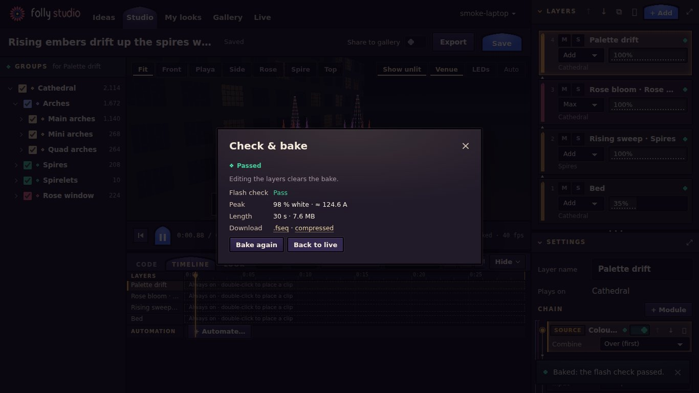

## 7. Frames on the wire

A bake is a **sparse FSEQ v2**: only the 14,610 channels the rig uses (33 ranges), not all 40,800, at the rig's
40 fps: about 0.6 MB a second on disk. To watch a bake in the browser, it is re-coded once, after the bake, for
streaming: chunks of 80 frames (2 s), each decodable alone, laid out frame-major or planar, raw or as deltas from
the frame before, whichever brotli compresses smallest; then brotli quality 9. Chunks live under content-hash
URLs served `immutable`, so watching again costs nothing and identical frames share one copy.

| 20 s at 40 fps, measured by `node tools/frames-bench.ts` | Size | Brotli 9 encode, one core |
|---|---|---|
| The sparse `.fseq` on disk | 11.69 MB | |
| On the wire: a calm wash (`colour-wash`) | 0.22 MB | 1.0 s |
| On the wire: the median of the 41 library sources | 0.64 MB | 1.6 s |
| On the wire: a 3-layer timeline look | 0.90 MB | 2.3 s |
| On the wire: the busiest source (`shimmer`, every LED glittering) | 4.49 MB | 5.4 s |
| Fresh random bytes every frame (the worst case) | 11.69 MB | 0.9 s |

Brotli 11 is 13 % smaller over the 41 sources, for 12 times the encode time, so 9 is the default. The bake in the
screenshots (24 s) streams as 1.2 MB, 8.6 % of its file, encoded in 3.2 s.

- **Alternatives.** The `.fseq` gzipped (several times larger); video codecs (lossy, so the LED values would not
  be the ones that play); streaming live renders from the server (CPU at home).
- **Trade-off.** One encode per bake on the server, at nice 10; plain-HTTP clients get a larger gzip copy.
- **Downloads.** The plain `.fseq` is the stored sparse file. A zstd (or zlib) compressed FSEQ, written as FPP's
  `FSEQFile` writes them, is opt-in (`?compress=1`). **Neither is verified on a real FPP or in xLights yet.** The
  Mirage match (§8) proves the plain file's addressing; the zstd form has been read only by our own strict parser
  and `tools/sacn-play.ts`.

## 8. Getting to the real Folly

| Path | Status |
|---|---|
| `.fseq` → FPP or xLights | Built; addressing proven (below); not yet verified on FPP or in xLights |
| `tools/sacn-play.ts` | Built: plays any studio `.fseq` (plain, sparse, zstd, zlib) as E1.31 on the rig's universes, as xLights' Output to Lights and FPP do; packets checked field by field |
| Live from the browser, headless player, TouchDesigner | Not built (`IDEAS.md`) |

**The proof that our output matches the sculpture's input** is the Mirage match (`npm run e2e`). It renders looks
whose colours encode each LED's identity, writes them with our FSEQ writer, plays them with `sacn-play` through
`relay/relay.js` into Mirage, which reads every pixel by its own universe and channel as the F48V5 controller does,
and compares: **all 4,870 LEDs match byte for byte**, and the studio's map equals TouchDesigner's pixel CSV row for
row. Mirage is independent code, so a shared mistake would have to be made twice.

## 9. The rig file

Everything installation-specific is one file, `public/data/rig.json`: every LED's position and address, fixtures
(`strip`, `points`, `cells`, `flood`) with render hints for the 3D view, the output (universes, channels per
universe, colour order, fps), axes, named camera views, a scaffold, and an xLights-style group tree whose groups
carry **tags** (`arch`, `spire`, `rose`, `canopy`, `wash`, `front`, …). Code, the library and the generators find
places by tag, never by the Folly's ids, so a look whose layers carry tags moves to another rig.

The Folly's is generated by `tools/build_rig.py` from `pixel-map/` through `td/python/make_pixel_csv.py`, the same
pipeline TouchDesigner and Mirage use, and never edited by hand. The proof it is general:
`test/fixtures/rigs/mini.json`, a fictional gate of three strips, an 8 × 8 panel and four floods, with different
axes, GRB order, 300-channel universes and 30 fps; the core and every library module run on it in the tests.

A new installation: write a generator from its canonical LED list (or hand-write a tiny rig); give axes, output,
one fixture per wire, panel, set of cells or flood with render hints; group it under one root and tag the groups
conventionally; replace `rig.json` and run `npm run check` (CONTRIBUTING "Adding a new installation").

## 10. The Playa view

Mirage's look (the night playa, glowing tubes, lit rose glass, flood beams, light spilling on the ground, bloom)
rebuilt in the studio's own WebGL2, from the rig's render hints alone. Each frame's light goes into one RGBA16F
texture that all geometry samples by pixel index, with no allocation per frame.

| Tier | Pixel ratio | Bloom | Spill lights | Chosen by Auto |
|---|---|---|---|---|
| Full | ≤ 2 | half-res | 16 | at start, on a laptop |
| Lite | 1 | quarter-res | 6 | at start, on a touch screen |
| Low | 1 | none | 4 | while the median of 24 frames takes over 30 ms |

**Points** (every LED a sprite) is the fallback when a browser cannot render to float targets, and the lightest
view by choice. Skipped from Mirage, on purpose: three.js (size, CDN), walk mode, the sun's path and time of day,
dust and haze, and per-zone hand-built geometry. The preview is about the light, must run on a phone, and must
work for any rig.

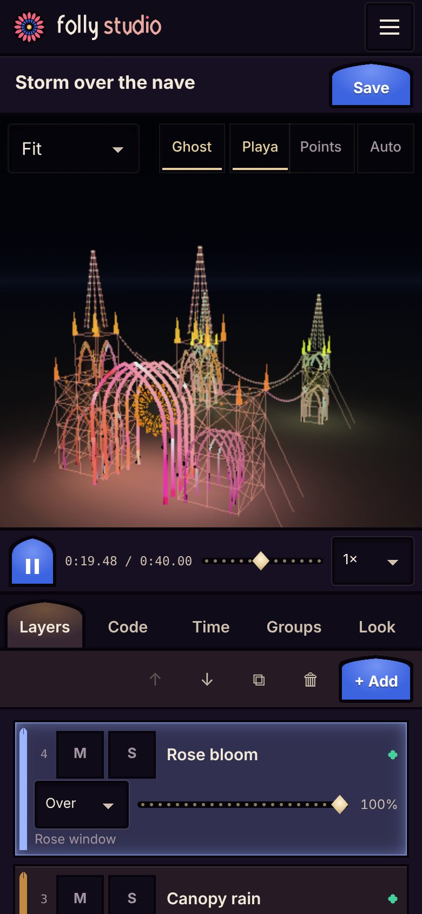

## 11. Idea → code generators

An adapter turns `{ text, library, rig, groups }` into a look; the result is cleaned statically by one zod schema
(`shared/schemas/generated.ts`: ≤ 4 layers, known groups and tags, code size, each module's function present, clips
mended or dropped with a note, globals and automation then held to the API's own rules) and never run on the
server.

| Generator | How | Cost |
|---|---|---|
| `sketch` (default) | Offline keyword match: library patterns and params; place words to tags | Instant, free, always on; the fallback |
| `claude` | One Messages API call with structured output (that schema as JSON Schema, group ids and tags as enums, so what the model may write and what the server keeps cannot drift apart; our own `fetch` client, no SDK). The system prompt (rig description, pattern guide, group tree, show taste, every library entry, five examples; ≈ 23 K characters, ≈ 5.9 K tokens) is cached; the idea goes only in the user turn, fenced as untrusted | Seconds, cents |
| `fleet` (experimental) | A boxed Codex worker per idea: writes `look.json`, checks and bakes it in its box, hands it back | Minutes; opt-in foundry |

**Fleet, assessed.** Its script-driven mode (`fleet up --no-coordinator`, `fleet spawn --here --box`, polling the
inbox) plus `report` raises fit well: a report hands back a file with no PR or review, exactly "here is your
look". The `--box` isolation (bubblewrap, no network, a private home, a relay capped at 50 model attempts, 30 minutes
of wall clock) fits a stranger's idea. Boxed Claude is refused today (network isolation blocks the API), so the worker is boxed
**Codex** only. Fleet is one machine with the owner's sign-in, so it is an **opt-in foundry** (`STUDIO_FOUNDRY=on`),
one job at a time, with other ideas going to the one-shot generator meanwhile. On WSL there is no systemd user bus,
so Fleet's boxes get **no memory cap**; the server warns at start.

- **Trade-off.** The AI works only inside the schema (§14); a broken generated look is caught in the sandbox, not
  repaired automatically yet.

## 12. Hosting on the owner's machine

- **Priorities.** People editing come first: bakes and frame encodes run one at a time at nice 10 in a shared
  lane, never together; the API stays responsive.
- **The server.** One Fastify process: routing, bodies, cookies, login limits and the static files are its
  plugins'; the auth design and the CSRF and caching rules are ours, as hooks. Static text is compressed once, at
  build time (`.br`, `.gz`), so serving the app costs no CPU. A login hashes with scrypt at OWASP's cost: half a
  second and 128 MiB, at most four at once (libuv's threads).
- **Caches.** Hashed immutable assets; API reads answer 304 to an ETag; idea polls back off (2 s to 10 s, never
  from a hidden tab); bakes reuse earlier frames by key; stream chunks by content hash.
- **Disk cap.** Baked frames are capped (`STUDIO_FRAMES_MAX_BYTES`, 2 GB, about an hour of frames), least
  recently used first, never a reviewed look's; an evicted bake is baked again when someone presses Play.
- **The tunnel.** Bind to 127.0.0.1 and reach out through Cloudflare Tunnel or Tailscale Funnel; no router
  ports. HTTPS matters: browsers ask for brotli only over it. With `STUDIO_TRUST_PROXY` the server takes the client
  address and host the tunnel forwards, from this machine only; never `trustProxy: true`, which would let a client
  name its own address and dodge the per-address login limit.
- **Backups.** `npm run backup`: a dated `.tar.gz`, safe while the server runs; daily from cron.
- **Storage.** JSON files, one per collection, written atomically: enough for tens of users; SQLite is the next
  step if it grows.

## 13. The theme

Stained glass and playa warmth: panels read as glass set in lead (dark outlines, jewel tints, a faint backlight),
with dust and sand as the warm secondary; pointed-arch tops on primary buttons and tabs; a sixteen-petal rose
window, drawn in SVG, as the logo, favicon, loader and idea progress. The wordmark is SVG, so there is no web
font. Copy is plain and says what happens ("Bake it in the render box to check it for flashing and power").
**The 3D view stays dark** so the LEDs carry all the colour.

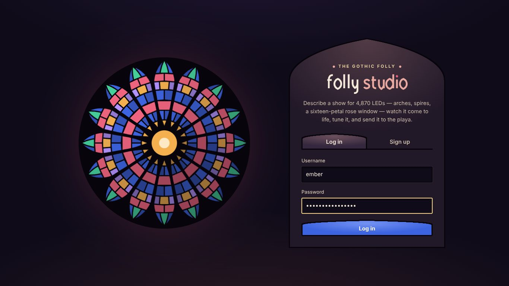

## 14. Known limitations

- **Stateful patterns drift.** The library's sources are tested to land on the same frame whether played or
  sought to. Anything that keeps state across frames (the trails filter; code people or the AI write that
  integrates in `frame()`) does not: the preview computes at 40, 30 or 20 fps as the device allows, the bake at
  40, and a seek does not rewind state. The baked frames are the truth.
- **No audio, no live input.** `bpm` is a number; there is no track, beat detection, MIDI, OSC or sACN in.
- **LEDs are points.** A pattern is sampled at each LED's position; cells and floods have extent only in the 3D
  view, and thin fast features can alias between LEDs unless drawn with `soft()` and `band()` or softened.
- **RGB pixels only.** Output is RGB triples in some order; no RGBW, dimmer channels, movers or other DMX fixtures.
- **Clips cannot sequence params**, only levels (automate a macro instead), and **no layer reads another's
  output**: filters see their own chain, and only the core's blur sees past a pixel (no user-written convolution).
- **CPU rendering bounds the rig.** 4,870 LEDs fit a phone's Worker (`npm run perf` holds a composed look at
  ≥ 20 fps on a 4× slowed CPU); ten times that would need the formula tier on the GPU.
- **The AI works inside the schema.** It can make what a look can hold (≤ 4 layers, modules, globals, clips,
  automation), nothing else, and does not see the frames it makes.
- **Not yet verified on FPP or in xLights**, the zstd downloads least of all (§7).
- **Single host.** One process, JSON files, one bake at a time: fine for tens of people, not hundreds.

## 15. Roadmap

The next most valuable steps, in order; `IDEAS.md` keeps the longer list.

1. **Play a bake on real FPP and xLights** (plain, sparse and zstd), then on the Folly through `sacn-play`.
2. **Music**: a track and a shared clock, `beat()` locked to it, the `.fseq` media header.
3. **A repair loop**: when a generated look throws in the sandbox, send the error back for a fix.
4. **Fixed-step preview** for stateful patterns, so the preview matches the bake.
5. **Param automation** on module params, and crossfades and markers between imported looks.
6. **Apply the power limit** the bake already estimates, as `folly_output` caps white.
7. **The formula tier**: looks that compile to GLSL, for TouchDesigner and for larger rigs.

## Screenshots

Taken from the real server with an owner and a curator account. The two Claude ideas ran against a stand-in for
the Messages API (one answers "busy", one never finishes), the rest is as the app made it. The 3D view is the Playa
view on Auto, which chose Full on the laptop and Lite on the phone. Headless Chromium draws with software GL, which
is why the laptop's fps counter reads low.

| | | |
|---|---|---|
|  |  |  |
| Sign in | Ideas, one generating | Studio: layers, chain, timeline |
|  | 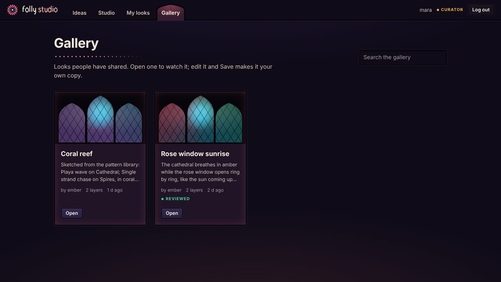 |  |
| Code tab, an inline error | Gallery | Bake report, baked playback |
| 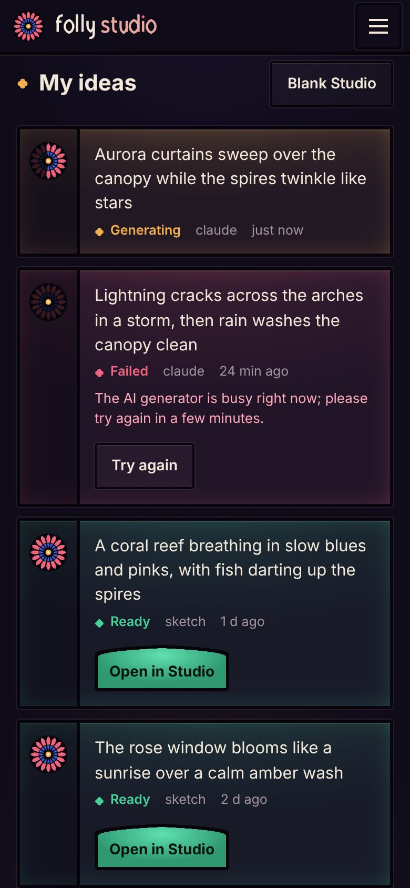  |   |  |
| Phone: ideas; Studio | Phone: Time tab; Look tab | Phone: library audition |
