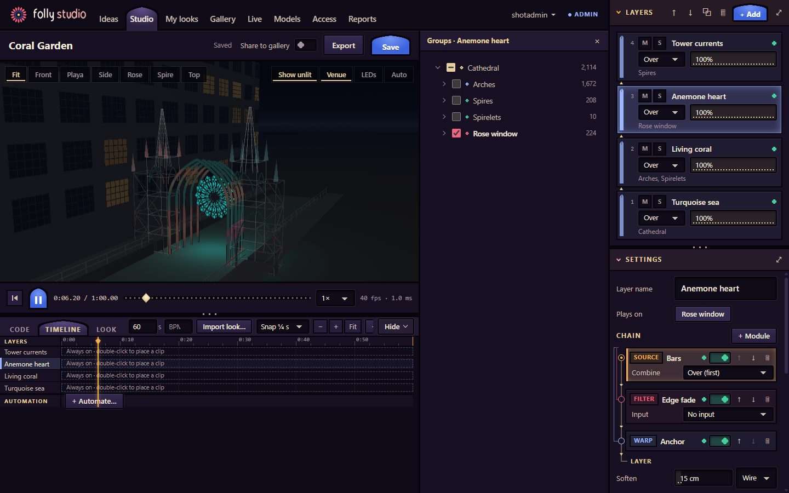

# Folly Studio

A web app where people compose a light show from a library of patterns, in layers on the Gothic Folly (the playa
build's 4,870 LEDs by default; City of Gods' 2,114 with `STUDIO_RIG=cog`), and shape it live on a model of the
sculpture from a laptop or a phone. Looks that should play are baked to frames in a render box, checked for flashing,
approved by a curator and exported as `.fseq` for FPP or xLights.



## Quick start

Node ≥ 22.18 and Python 3.

```sh
npm ci                 # the dependencies, exactly as package-lock.json pins them
npm start              # builds the app into dist/, then http://127.0.0.1:8780/ (data in ./data/; sign up, then
                       #   open the Studio)
npm run dev            # the same with Vite's dev server and hot reload, on http://127.0.0.1:5173/
npm run check          # typecheck, lint, then every test: green before anything is done
```

- Bakes need prlimit (util-linux); only looks of library patterns save and bake (spec/frames "Where bakes run").
  Admins can throttle baking or turn it off (Admin › Baking).
- Curators: `STUDIO_CURATORS=alice,bob`; admins: `STUDIO_ADMINS=you`.
- The rigs come from a lighting checkout (The-Gothic-Folly/lighting, `LIGHTING_DIR`, by default `../lighting`):
  `npm run build-data` after its pixel maps change; never edit a rig by hand.
- CONTRIBUTING has every command (the browser checks `smoke`, `perf` and `e2e`, and what they need), the settings
  and the show data.

## Read next

| Document | For |
|---|---|
| [DESIGN.md](DESIGN.md) | What is built, why, the trade-offs and the limits |
| [SPEC.md](SPEC.md) | The contract: ground rules, and the index of the area files in `spec/` |
| [docs/HOSTING.md](docs/HOSTING.md) | Running it at home: what runs where, tunnels, settings, backups |
| [CONTRIBUTING.md](CONTRIBUTING.md) | Layout, dependencies, TypeScript, the rules and why, security invariants, budgets, adding an installation |
| [IDEAS.md](IDEAS.md) | Where it could go next |
