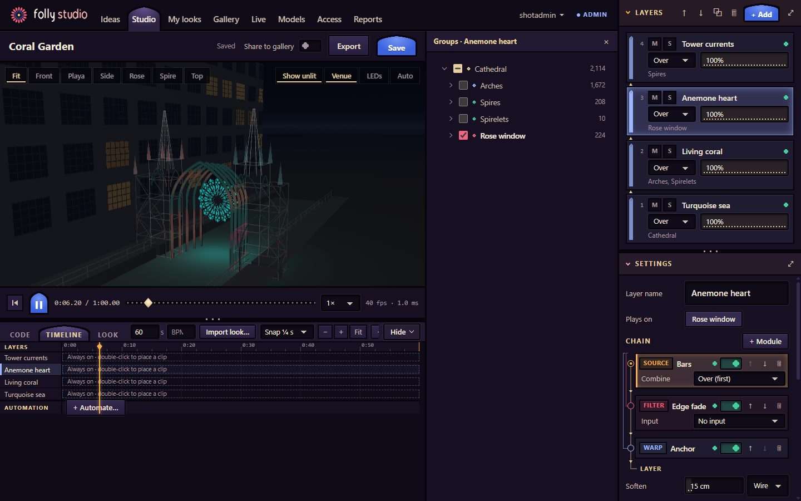
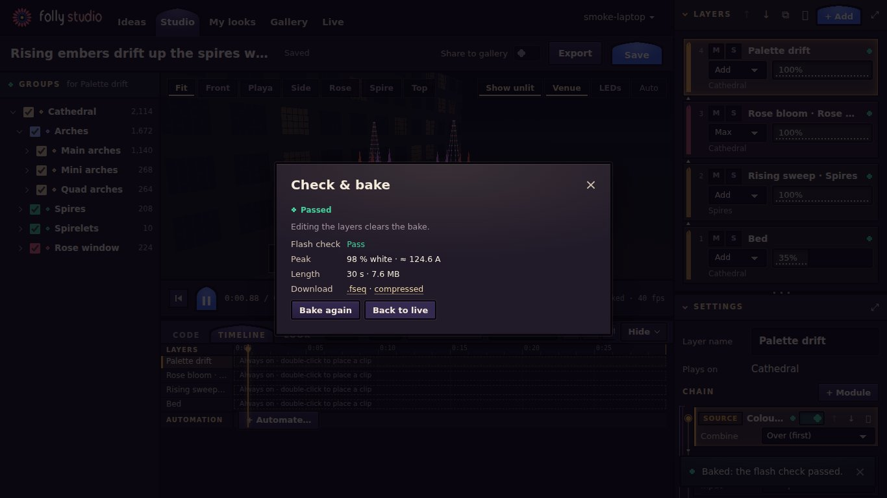
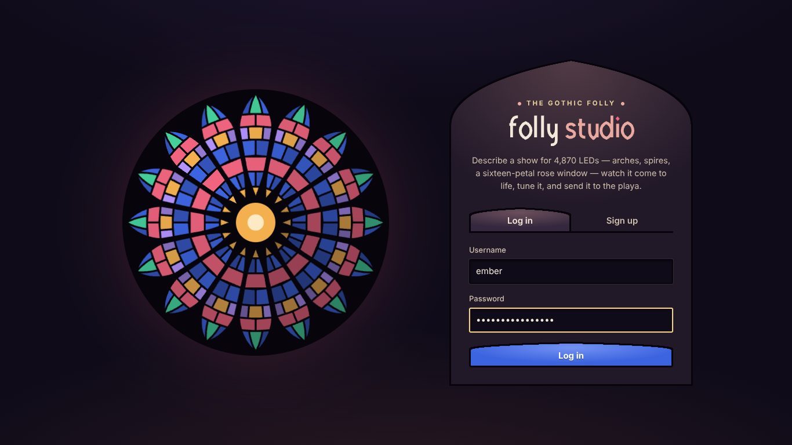

# Folly Studio — design

Why Studio is built the way it is: each decision, what it was weighed against and what it costs; what it cannot do;
and where it could go. What it does is the contract, [SPEC.md](../SPEC.md); how to run it, [HOSTING.md](HOSTING.md).



## 1. Product shape

People compose a **look** from the library in layers on groups of the Gothic Folly, preview it live on a phone or a
laptop, and share it. A look that should play on the Folly is **baked** to frames on the server, **reviewed** by a
curator and **exported** as `.fseq`.

```
account → look → live preview → bake → curator review → .fseq export
           (library)  (phone/laptop)  (render box)  (frames, not code)
```

It is hosted on the owner's computer for tens of people (the camp and friends), behind an HTTPS tunnel. Each viewer
renders their own preview, so the server only stores, serves and bakes, one bake at a time.

- **Alternatives.** A desktop app (no shared gallery, no phones), a hosted service (cost and operations for a few
  dozen users), an xLights plugin (desktop-only C++, no phones or gallery).
- **Trade-off.** The server is a personal machine: its uptime and upload are the service's.
- **The UI.** Preact with signals. The look being edited is one signal, replaced on each edit; everything that
  follows from it is computed, so no panel keeps another in sync by hand. The WebGL view, the sandbox runtime and the
  frames stream stay imperative behind thin components, and nothing renders per frame.

## 2. Dependencies

A dependency is welcome when it makes life easier (CONTRIBUTING "Dependencies" says why each is there), within the
ground rules in SPEC.md: offline on the playa, and the browser's budgets (CONTRIBUTING "Performance budgets").
Fastify serves, zod holds the shapes both sides share so the types come from the rules, Vite builds only the
browser's code, and Node runs the rest as written so what runs is what is in git.

- **Alternatives.** No dependencies (no supply chain, but unminified code and our own build machinery); React
  (several times Preact's 11 KB with signals) or Svelte (a compiler of its own); three.js for the 3D view (alone it
  would fill the budget).
- **Trade-off.** A build and a lockfile to keep current. We still own the WebGL, the checks oxlint lacks
  (`tools/budgets.ts`) and the auth design: the auth libraries are deprecated, a framework of their own, or
  stateless and so not revocable.

## 3. The pattern model

A pattern is a plain script whose `pixel(p, t, P, G)` returns each LED's colour every frame, with a stdlib in scope
and a pixel that addresses the Folly every useful way: space, polar round the layer, along the wire, and its
structure and tags (spec/library "The pixel `p`").

- **Why JavaScript.** Whoever adds a library pattern can read and write it, and state across frames (particles,
  trails, automata) needs a real language.
- **Alternatives.** A formula language (safe and portable to GLSL, but too small for stateful effects); GLSL
  (fast, but state and logic along strands are awkward, and a runaway shader stalls a phone's GPU).
- **Trade-off.** It has to be sandboxed (§6) and runs on the CPU (§11).
- **Determinism.** Only stable randomness (`rand`, `hash`, `noise`, `seed`), so a look bakes to the same bytes and
  a bake is reused by its key.

## 4. Composition

A layer is a **chain of modules** under one rule: each works on everything above it, as in an image editor
(spec/library "Modules"). Per pixel it is one pass with no intermediate buffers, so it costs no memory per frame and
stays cheap on a phone.

- **One idea a module.** The library is single ideas that chains combine; an idea that needs a bed, a second motion
  or a warp is a **preset**, a recipe of modules. Shared conventions make the pieces fit: one `colours` pick per
  source, one list of directions, motion from integrated clocks so binding a speed never jumps, and drawing on
  transparent over a bed. Splitting costs per-pixel work, so presets are timed in `npm run perf` beside the sources.
- **Blur is the core's.** The one thing a pixel cannot do alone is read its neighbours, so the core does it natively
  (`blur`, each layer's `soften`) from a neighbour graph built once per rig; a chain with a blur runs in stages round
  it, and one without keeps its single pass. A warp stops at a blur or trails: there is no colour at a bent position
  to read.
- **Colours are picks, not hexes.** A source knows nothing of palette roles; people choose its colours from the
  look's palette, so swapping the palette restyles the look. Palettes come from the CSVs TouchDesigner uses, so a
  look and a TD show agree on colour.
- **Alternatives.** Per-layer frame buffers in a node graph (any spatial filter, at a frame per node per layer);
  blur in pattern code (slow, and blind past its own pixel); xLights' palette per effect (a new palette means editing
  every effect); per-layer role remaps (roles on every source made no sense to people).
- **Trade-off.** No layer reads another's output, and blur is the only spatial operation.

## 5. The timeline

Sequencing lives on the look, xLights-style: clips on each layer with fades (spec/looks "Timeline"). **A clip only
scales its layer's level** and **patterns run on show time**, so motion carries on across a cut instead of
restarting. This is TouchDesigner's `folly_cues` model: it crossfades levels, and every look keeps its clock.

- **Alternatives.** xLights' effect-local time (a cut jumps); keyframed params on every module (a much bigger editor
  and file).
- **Trade-off.** Clips cannot sequence params (automate a macro instead), and a layer at envelope 0 is skipped, so a
  stateful pattern pauses while it is off.

## 6. Trust and safety

**Only library patterns run**, and never on the server's own process: in the browser's sandboxed Worker, with a
watchdog, and on the server in the render box, its own process under limits (spec/library "Sandbox protocol",
spec/frames "Baked frames"). What a box hands back is data.

**Curators approve baked frames, and those frames are what plays.** A curator judges bytes that cannot change, not
code that might behave differently at showtime; any edit clears the bake and the review.

**Flash checks** adapt WCAG 2.3.1 to a sculpture and catch only big, fast, wide flashing. A flash is a swing of half
the LEDs' light, where WCAG counts a tenth, which would stop most lively looks; it is measured on each LED's
brightest channel, so a saturated red strobe counts in full. Flashes are credited to the places that made them, so a
wave crossing the arches flashes each once. Large-area flashing blocks review unless a curator gives a reason, which
is kept; small-area flashing warns. The preview runs the same rule and dims a strobe, which each person may turn off.

- **Alternatives.** `node:vm` alone (not a security boundary), isolated-vm (a native dependency), containers or
  microVMs (heavy for a home host), previews rendered on the server (CPU and latency at home).
- **Trade-off.** Only library code saves, so the box needs no namespaces: prlimit and a scope suffice.



## 7. Frames on the wire

A bake is a **sparse FSEQ v2**, only the channels the rig uses. To watch one in the browser it is re-coded once for
streaming: chunks of 2 s, each in whichever layout brotli compresses smallest, under content-hash URLs, so watching
again costs nothing and identical frames share one copy (spec/frames "Baked frames").

| 20 s at 40 fps on City of Gods (`node tools/frames-bench.ts`) | Size | Brotli 9 encode, one core |
|---|---|---|
| The sparse `.fseq` on disk | 5.07 MB | |
| On the wire: a calm wash | under 0.01 MB | 0.1 s |
| On the wire: the median library source | 0.19 MB | 0.3 s |
| On the wire: the busiest source (`fire`) | 1.98 MB | 1.1 s |

Brotli 11 is 11 % smaller for 10 times the encode time, so 9 is the default.

- **Alternatives.** The `.fseq` gzipped (several times larger); video codecs (lossy, so not the LED values that
  play); live renders streamed from the server (CPU at home).
- **Trade-off.** One encode per bake on the server; plain-HTTP clients get a larger gzip copy.

## 8. Getting to the real Folly

| Path | Status |
|---|---|
| `.fseq` → FPP or xLights | Built; addressing proven (below); not yet verified on FPP or in xLights, the zstd form least of all |
| `tools/sacn-play.ts` | Built: plays any studio `.fseq` as E1.31 on the rig's universes; packets checked field by field |
| The live stage, the Pi's engine, relay to the lights | Archived ([ARCHIVE.md](../ARCHIVE.md)) |
| Live sACN from the server, TouchDesigner | Not built (§12) |

**The proof that our output matches the sculpture's input** is the Mirage match (`npm run e2e`): looks whose colours
encode each LED's identity, written by our FSEQ writer and played by `sacn-play` into Mirage, which reads every pixel
by its own universe and channel as the controller does. All 4,870 of the Folly's LEDs match byte for byte. Mirage is
independent code, so a shared mistake would have to be made twice. City of Gods is held to its xLights show's
channels instead.

## 9. The rig file

Everything installation-specific is one file, the rig `STUDIO_RIG` picks (spec/rig "Rig"), generated from the
lighting repo's pixel maps, the pipeline TouchDesigner and Mirage use. Code and the library find places by group
**tags**, never by the Folly's ids, so a look whose layers carry tags moves to another rig. The proof it is general
is `test/fixtures/rigs/mini.json`, a fictional gate with different axes, colour order, universes and fps, on which the
core and every library module run in the tests. Adding an installation: CONTRIBUTING "Adding a new installation".

## 10. The Playa view and the theme

Mirage's look (the night playa, glowing tubes, lit rose glass, flood beams, spill, bloom) rebuilt in our own WebGL2
from the rig's render hints alone, in quality tiers a phone can carry (spec/rig "The 3D view"). Skipped from Mirage,
on purpose: three.js (size, a CDN), walk mode, time of day, haze and hand-built geometry per zone. The preview is about
the light, must run on a phone, and must work for any rig.

The theme is stained glass and playa warmth: panels as glass set in lead, pointed-arch tops on primary controls, a
sixteen-petal rose as the logo, and no web font. Copy is plain and says what happens. **The 3D view stays dark** so
the LEDs carry all the colour.



## 11. Known limitations

- **Stateful patterns drift.** The library's sources land on the same frame whether played or sought to; anything
  that keeps state across frames (trails) does not, since the preview computes at 40, 30 or 20 fps as the device
  allows and a seek does not rewind state. The baked frames are the truth.
- **No audio, no live input.** `bpm` is a number; there is no track, beat detection, MIDI, OSC or sACN in.
- **LEDs are points.** A pattern is sampled at each LED; thin fast features alias unless drawn soft or softened.
- **RGB pixels only.** No RGBW, dimmer channels, movers or other DMX fixtures.
- **CPU rendering bounds the rig.** 4,870 LEDs fit a phone's Worker; ten times that would need the GPU.
- **Saved params follow the library only as far as its upgrade hooks.** A look names its modules, so it plays their
  current code; a param renamed without an `upgrade()` leaves saved looks on the old one.
- **Single host.** One process, JSON files, one bake at a time: fine for tens of people, not hundreds.

## 12. Roadmap

In order of value:

1. **Real hardware.** Play studio `.fseq` files (plain, sparse, zstd) on FPP and in xLights, then on the Folly
   through `sacn-play`, curator-approved bakes only.
2. **Music.** Load a track; one clock for the song and the look; `beat(t, bpm)` locked to it; `.fseq` with a media
   header.
3. **The preview matches the bake for stateful patterns.** Run `frame()` at fixed 40 fps steps in the preview.
4. **Timeline.** Crossfades between imported looks; markers for sections and cues (`folly_cues`, `shows/show.tsv`).
5. **Power.** Apply the limit the bake already estimates (`estPeakAmps`), as `folly_output` caps white.
6. **A formula tier.** A pure-expression subset of pattern code that compiles to JS and to GLSL: a look becomes a
   TouchDesigner GLSL TOP feeding `pixel_mapping`, and rigs far larger than the Folly preview on the GPU.
7. **Hosting.** SQLite instead of JSON files; magic-link or OAuth sign-in.
8. **Beyond RGB.** RGBW pixels and other DMX fixtures in the rig's output.
