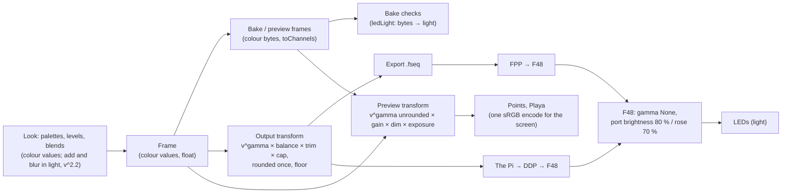

# Light and colour

How a colour in Studio becomes light on the sculpture, and every correction on the way: where it is, why it is
there, and the setting that tunes it. SPEC "Light and output" is the contract; this page is the reasoning.

## Two kinds of number

- **Colour values** (encoded, 0..1). A swatch's own sRGB numbers: `#808080` is 0.5. Every look, pattern, palette,
  level, Amount, fade and crossfade works in these. They are *perceptual*: 0.5 looks about half as bright as 1.
- **Light** (linear, 0..1 of full). What an LED actually emits: its PWM duty. Twice the number is twice the photons.

An LED's light is not its value. Half the light (0.5) looks much brighter than half (about 0.73 as a value), which
is why a straight value-to-PWM mapping makes every dim look washed out. The bridge between the two is a power
curve, the **gamma**: `light = value ^ gamma`.

## What adds light

Two things in the engine add light rather than scale a value: the `add` blend (a chain's sources, and layers onto
the frame) and blur (Soften). Summing values is wrong for those: two 50 % layers summed as values make 100 %, four
and a half times the light of either, where two lamps make twice it. So these take each value's light, sum or average
it, and encode again (`toLight`, `toValue` and `addLight` in `core/light.ts`):

| | As values (before) | In light (now) |
|---|---|---|
| Two 50 % layers, `add` | 100 % | 68 % (twice 22 % of the light) |
| 50 % onto 25 %, `add` | 75 % | 54 % |
| A lit LED's neighbour, Soften | its share of the value | its share of the light, encoded: brighter, so a lit edge doesn't sink into a dark rim |

- **The curve is a fixed `v^2.2`, never the Light page's gamma.** The swatches are sRGB: 2.2 is their own curve, the
  meaning of a colour value. The Light gamma corrects the LEDs to those swatches, at the output only, so tuning it
  never changes a frame, a bake or a check's input, and the same look renders the same on every machine.
- **What scales stays in values**: alpha, level, Amount, fades, `over`, crossfades and `mix()` (a slider's 0.5 should
  look half). They scale a value before it is added.
- **`max` and `multiply` are unchanged**: under a power curve the brighter value has the brighter light, and a
  product's light is the product of the lights, so working in light gives the same answer.
- The curve is a table (1,024 linear steps, within 1e-5 of `v^2.2`): it runs per LED, per layer, every frame, and
  `pow` is twenty times slower. Below 0 it mirrors, so a negative value still takes light away.

## The path

## Every correction

| Where | What | Why | Tune it |
|---|---|---|---|
| The engine's add and blur (`core/light.ts` `addLight`) | `value = (Σ v^2.2)^(1/2.2)`; blur averages light the same way | Light adds, values don't: two 50 % layers make 68 %, not 100 % | None: 2.2 is the swatches' curve, part of what a colour means |
| Output transform (`core/light.ts` `ledChannels`) | `byte = round(255 · min(1, v^gamma · balance[colour] · trim[LED] · cap))` | Turns perceptual values into the PWM that looks like them. One curve, applied once, in float, rounded once at the end | Light page (Admin › Light): Gamma (default 2.2) |
| Same, `balance` | × each colour's share | Matches the LEDs' white to the eye: trim the colour that runs strong. Never above 100 %: that would only clip | Light page: Red/Green/Blue balance (default 100 %) |
| Same, `floor` | A lit channel never sends less than `floor` | 8 bits run out at the bottom: at gamma 2.2 any value under about 0.06 rounds to 0, so a faint bed vanishes. The floor keeps it glowing (at the cost of the very bottom of a fade looking stepped) | Light page: Floor (default 0, off) |
| Same, `trim` | A group's light × its level, by rig tag | A part that runs bright (denser LEDs, a different strip) can match the rest | Light page: Trims (none by default) |
| Same, `cap` | Light × the Pi's master × blackout × fade, or Export's Brightness | A cap after the curve scales light, so dimming never shifts a hue (as WLED and FPP do). Before the curve it would, and it would also land the dim deep in the crushed bottom | The Pi's master; Export's Brightness |
| The F48 (the controller's own settings) | Port brightness 80 % (ports 5–32), 70 % (the rose, 33–48); gamma None | The electrical and thermal backstop, set on the controller. Its gamma is None so ours is the only curve | On the Falcon only. The Light page records them, and Studio never applies them |
| Bake checks (`src/frames.ts`, `core/flash.ts`) | Each baked byte → its light through the same curve (`ledLight`) | Dark, harsh, flashing and power are about light, not colour values | Follows the Light page; judged at full output (no caps or trims), with the settings the bake ran with |
| The Pi's live flash guard | The same, × the master | Watches what actually goes out | Follows the Pi's light.json |
| Preview transform (`core/light.ts` `previewChannels`, both views) | Each value's LED light, `v^gamma`, unrounded but off where the LEDs round to off, at least the floor | The views show what the LEDs give, not the colour values: a 50 % swatch shows 22 % of full's light on screen as on the sculpture | Follows Gamma and Floor. Balance and trims stay out: they make the LEDs match the swatches, which the screen already does |
| Same, `gain` and the dims | Light × the flash guard's dim or the Live master; × the highlight's or the focus's dim outside it | Applied once, in light, before either view draws, so Points and Playa dim alike, and the Live master shows as the Pi gives it | Light page: Highlight dim (22 %), Focus dim (5 %) |
| Same, `exposure` | Light × exposure | Where full drive sits on the screen. 0.85 is Playa's tone-map shoulder: below it every level shows in proportion; above, the top compresses (Playa) or clips (Points) | Light page: Exposure (default 85 %) |
| Points (`viewer-gl.ts`) | A sprite whose profile peaks at 1; overlapping sprites take the brighter (max), not the sum | The sprite's centre is the LED's light; a sum of encoded halos overshot (+36 green on a full orange rig) | None |
| Playa (`playa/`) | Each fixture's emission 1 at its brightest pixel (floods cast a share); bloom keeps light over 0.5 | Full drive at the default exposure stays under the shoulder; bloom is a camera's glow, added on top | Light page: Bloom (default 40 %, 0 is off) |
| Both views' encode (`core/light.ts` `ENCODE`) | Light → sRGB code, one curve (Ian Taylor's fit, within a quarter of a code) | The screen decodes sRGB; a software renderer's pow is slow | None |
| Both views' ghost | An unlit LED shows faintly (Show unlit), fading out as it lights | The rig's shape at night, never a tint under a lit LED | Show unlit, per browser |

The F48's caps multiply after all of this: a full white on a port at 80 % is 80 % of the LEDs' rated light. The
Light page shows them so the whole chain is in one place. Never set them in software too, or the sculpture is
dimmed twice.

### The curve in numbers (gamma 2.2, white, no balance)

| Value | 100 % | 75 % | 50 % | 25 % | 10 % | 6 % | 3 % |
|---|---|---|---|---|---|---|---|
| Sends (of 255) | 255 | 135 | 55 | 12 | 2 | 1 | 0 |
| Light | 100 % | 52.9 % | 21.6 % | 4.7 % | 0.8 % | 0.4 % | 0 |
| On screen, Points and Playa (exposure 0.85) | 237 | 179 | 119 | 57 | 17 | 6 | 0 |

The Light page shows this table live as gamma, the floor and the exposure change. `test/light.test.js` pins it, and
the probes below read the same pixels off the GPU.

### Why rounding once is not enough at the bottom

The transform is computed in float and rounded once, so it wastes no codes. But a byte is still a byte: below about
0.06 the light is under half a step and rounds to off, whatever order things happen in. Two real fixes exist: the
`floor` (here, now) and temporal dithering on the Pi (alternating neighbouring bytes, not built). Looks should keep
a bed at 0.15 or more.

## Where the settings live

- Studio: `<STUDIO_DATA>/light.json`, edited on the admin **Light** page (`PUT /api/admin/light`). Missing or
  unreadable, every field is its default; a field missing from the file is its default. Export and every new bake
  read it.
- The Pi connects to nothing, so it reads the same record from `pi/light.json`: the Light page's **Download for the
  Pi**, copied over. The host's dry-run Pi (`deploy/host.sh`) reads Studio's own file.
- Not in `rig.json`: that is the installation's map, built from the pixel map, and these are how we drive it.

## The previews

The engine and the bakes stay in colour values, and the screen is an sRGB display. So both views take each frame
through the preview transform (above), once, and encode the light for the screen with one curve: what they show is
the LEDs' light, in proportion, at the exposure.

Measured with the real `Viewer` on the real rig (a lone strip LED, front view, its brightest pixel; the probes are in
the fleet's reports, `lightfix/probe/`), before and after:

| A lone LED | Points before | Playa before | Points after | Playa after |
|---|---|---|---|---|
| Orange `#ff8000` | 255, 161, 39 | 252, 128, 28 | 234, 118, 22 | 238, 120, 0 |
| Orange at 50 % (the LEDs: 22 % of full's light) | 155, 92, 39 (33 %) | 150, 82, 35 (31 %) | 118, 56, 22 (22 %) | 120, 57, 0 (22 %) |
| Orange, outside a focus | 16, 21, 36 | 53, 35, 33 | 56, 23, 21 | 58, 25, 0 |
| Orange, outside a highlight | 70, 44, 25 | 152, 79, 34 | 116, 55, 21 | 120, 57, 0 |
| Every LED orange (overlap) | 255, 197, 43 | 251, 128, 28 | 233, 117, 21 | 237, 119, 0 |

- Points and Playa now agree within the sprite's sampling (a few codes), and a dim means the same in both.
- Playa's figures are its Low tier. Full adds the bloom, a camera's glow: +9 on a lone full orange LED, +16 with
  every LED lit, and nothing at 50 %.
- No clip and no ghost under a lit LED: Points' blue (21) is the night sky behind it, Playa's is gone.
- A 50 % swatch shows 22 % of full's light, as the LEDs give it; before, the views showed 31–33 %.
- Full drive shows at 237, not 255: that is the exposure keeping the top in proportion. Exposure 100 % shows full as
  the swatch (255) and compresses the top.
- Playa's night (sky, haze, the playa's own light) is set as dark as the old tone map's toe left it; the toe itself
  is gone, since it darkened the LEDs' own low light too.
