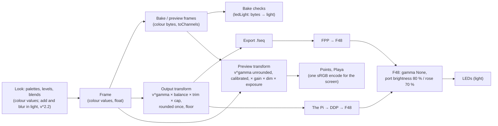

# Light and colour

How a colour in Studio becomes light on the sculpture, how Studio draws that light, and every correction on the
way: where it is, why it is there, and the setting that tunes it. The real LEDs are the truth: the Light page
calibrates the previews to them, and its output gamma is the one setting there that changes what the Pi sends.
SPEC "Light and output" is the contract; this page is the reasoning.

## Two kinds of number

- **Colour values** (encoded, 0..1). A swatch's own sRGB numbers: `#808080` is 0.5. Every look, pattern, palette,
  level, Amount and clip fade works in these; colour fades go through OKLab (below). They are *perceptual*: 0.5 looks about half as bright as 1.
- **Light** (linear, 0..1 of full). What an LED actually emits: its PWM duty. Twice the number is twice the photons.

An LED's light is not its value. Half the light (0.5) looks much brighter than half (about 0.73 as a value), which
is why a straight value-to-PWM mapping makes every dim look washed out. The bridge between the two is a power
curve, the **gamma**: `light = value ^ gamma`.

**The output gamma is 2.65 by default**, and tuneable on the Light page (1..3). The F48's
ports are gamma None, and the other players on the lights (FPP, the live apps) send their colour values with no
curve: at 1 a colour gives the same light whichever of them plays it. The previews draw whatever gamma is set, so
they show what the LEDs give; set it by the real LEDs beside the preview.

## What adds light

Two things in the engine add light rather than scale a value: the `add` blend (a chain's sources, and layers onto
the frame) and blur (Soften). Summing values is wrong for those: two 50 % layers summed as values make 100 %, four
and a half times the light of either, where two lamps make twice it. So these take each value's light, sum or average
it, and encode again (`toLight`, `toValue` and `addLight` in `core/light.ts`):

| | As values | In light |
|---|---|---|
| Two 50 % layers, `add` | 100 % | 68 % (twice 22 % of the light) |
| 50 % onto 25 %, `add` | 75 % | 54 % |
| A lit LED's neighbour, Soften | its share of the value | its share of the light, encoded: brighter, so a lit edge doesn't sink into a dark rim |

- **The curve is a fixed `v^2.2`, never the output gamma.** The swatches are sRGB: 2.2 is their own curve, the
  meaning of a colour value. The output gamma is the Pi's, at the output only, so it never changes a frame, a bake or
  a check's input, and the same look renders the same on every machine.
- **What scales stays in values**: alpha, level, Amount, clip fades, `over` and `mix()` on numbers (a slider's 0.5
  should look half). They scale a value before it is added.
- **`max` and `multiply` are unchanged**: under a power curve the brighter value has the brighter light, and a
  product's light is the product of the lights, so working in light gives the same answer.
- The curve is a table (1,024 linear steps, within 1e-5 of `v^2.2`): it runs per LED, per layer, every frame, and
  `pow` is twenty times slower. Below 0 it mirrors, so a negative value still takes light away.

## Colour fades

A fade from one colour to another (`mix()` and `gradient()` on colours, a smooth pick's ramp, a turning pick's
crossfade) goes through OKLab (`core/oklab.ts`): each end's light at the same fixed `v^2.2`, Björn Ottosson's
OKLab, straight across, back to light and encoded again. OKLab's lightness is perceptual, so a fade holds its
brightness and passes through the hues a viewer expects between the two ends:

| Fade, half-way (luminance) | As values | In OKLab |
|---|---|---|
| Red (0.21) to green (0.72) | `#808000`, muddy olive, 0.20: darker than red | `#cfa704`, amber, 0.42 |
| Blue (0.07) to yellow (0.93) | `#808080` grey, 0.22 | `#6baac6`, light blue, 0.37 |
| Red to cyan (0.79) | `#808080` grey, 0.22 | `#d1a892`, warm beige, 0.44 |
| Black to white | `#808080`, 0.22 | `#636363`, 0.13: OKLab's middle grey, so a fade toward black darkens sooner |

- **Plain OKLab, not OKLCh.** A fade goes straight through the middle, so distant hues meet paler (red to cyan
  through beige) rather than sweeping round the wheel.
- **Out of gamut**, each channel is clamped to 0..1, widened to an end that lies outside it (a bright pattern's
  values over 1 stay).
- **Numbers stay linear**: `mix(2, 4, 0.5)` is 3. Alpha, `over`, levels and clip fades scale values, as above.
- **Cost**: about 0.08 µs a pixel when the ends repeat, 0.2 µs when both vary, against 0.01 µs for a fade
  of values. Each side keeps its last colour's OKLab, so a ramp's stops are converted once, not per pixel.
  A fixed ramp (a pick's or a palette role's) reads a table of its fades' light instead, about 0.08 µs whatever
  its ends, its light within 0.05/255 of the fade's (an LED byte moves by 1 at most).

## The path

## Every correction

| Where | What | Why | Tune it |
|---|---|---|---|
| The engine's add and blur (`core/light.ts` `addLight`) | `value = (Σ v^2.2)^(1/2.2)`; blur averages light the same way | Light adds, values don't: two 50 % layers make 68 %, not 100 % | None: 2.2 is the swatches' curve, part of what a colour means |
| Output transform (`core/light.ts` `ledChannels`) | `byte = round(255 · min(1, v^gamma · balance[colour] · trim[LED] · cap))` | Turns perceptual values into the PWM that looks like them. One curve, applied once, in float, rounded once at the end. While the cap holds (two frames running, no trims) it goes by a table of each byte's least value, which sends exactly the same bytes in a seventh of the time | Light page: Output gamma (1..3, default 2.65); the Pi takes a saved one within seconds |
| Same, `balance` | × each colour's share | Trims the colour that runs strong. Never above 100 %: that would only clip | `light.json`: `balance` (default 100 %) |
| Same, `floor` | A lit channel never sends less than `floor` | 8 bits run out at the bottom: at gamma 2.2 any value under about 0.06 rounds to 0 (at 1, under 0.002), so a faint bed vanishes. The floor keeps it glowing (at the cost of the very bottom of a fade looking stepped) | `light.json`: `floor` (default 0, off) |
| Same, `trim` | A group's light × its level, by rig tag | A part that runs bright (denser LEDs, a different strip) can match the rest | `light.json`: `trims` (none by default) |
| Same, `cap` | Light × the Pi's master × blackout × fade, or Export's Brightness | A cap after the curve scales light, so dimming never shifts a hue (as WLED and FPP do). Before the curve it would, and it would also land the dim deep in the crushed bottom | The Pi's master; Export's Brightness |
| The F48 (the controller's own settings) | Port brightness 80 % (ports 5–32), 70 % (the rose, 33–48); gamma None | The electrical and thermal backstop, set on the controller. Its gamma is None so ours is the only curve | On the Falcon only. The Light page records them, and Studio never applies them |
| Bake checks (`src/frames.ts`, `core/flash.ts`) | Each baked byte → its light through the same curve (`ledLight`) | Dark, harsh, flashing and power are about light, not colour values | Follows the output fields; judged at full output (no caps or trims), with the settings the bake ran with |
| The Pi's live flash guard | The same, × the master | Watches what actually goes out | Follows the Pi's light settings, live |
| Preview transform (`core/light.ts` `previewChannels`, both views) | Each value's LED light, `v^gamma` × balance, unrounded but off where the LEDs round to off, at least the floor, in the output transform's order | The views show what the LEDs give, not the colour values: a 50 % swatch shows 22 % of full's light at gamma 2.2 (half at 1), on screen as on the sculpture | Follows the output fields; trims stay out |
| Same, `calibration` | Light^`response` × each colour's `white`, then `saturation` about the luminance (Rec. 709 weights), in light | The real LEDs are not an sRGB screen: their white leans, their primaries run deeper, their light may not follow the PWM. Set from photos of the real lights beside the preview, so the render shows what shows up | Light page: Red/Green/Blue white (0..200 %), Response (0.5..2), Saturation (0..200 %); 100 %, 1, 100 % draw the swatches |
| Same, `gain` and the dims | Light × the flash guard's dim or the Live master; × the highlight's or the focus's dim outside it | Applied once, in light, before either view draws, so Points and Playa dim alike, and the Live master shows as the Pi gives it | Light page: Highlight dim (22 %), Focus dim (5 %) |
| Same, `exposure` | Light × exposure | Where full drive sits on the screen. 0.85 is Playa's tone-map shoulder: below it every level shows in proportion; above, the top compresses (Playa) or clips (Points) | Light page: Exposure (default 85 %) |
| Points (`viewer-gl.ts`) | A sprite whose profile peaks at 1; overlapping sprites take the brighter (max), not the sum | The sprite's centre is the LED's light; a sum of encoded halos overshot (+36 green on a full orange rig) | None |
| Playa (`playa/`) | Each fixture's emission 1 at its brightest pixel (floods cast a share); bloom keeps light over 0.5 | Full drive at the default exposure stays under the shoulder; bloom is a camera's glow, added on top | Light page: Bloom (default 40 %, 0 is off) |
| Both views' encode (`core/light.ts` `ENCODE`) | Light → sRGB code, one curve (Ian Taylor's fit, within a quarter of a code) | The screen decodes sRGB; a software renderer's pow is slow | None |
| Both views' ghost | An unlit LED shows faintly (Show unlit), fading out as it lights | The rig's shape at night, never a tint under a lit LED | Show unlit, per browser |

The F48's caps multiply after all of this: a full white on a port at 80 % is 80 % of the LEDs' rated light. The
Light page shows them so the whole chain is in one place. Never set them in software too, or the sculpture is
dimmed twice.

### The curve in numbers (white, no balance)

| Value | 100 % | 75 % | 50 % | 25 % | 10 % | 6 % | 3 % |
|---|---|---|---|---|---|---|---|
| Gamma 2.65 (the default): sends (of 255) | 255 | 119 | 41 | 6 | 1 | 0 | 0 |
| Light | 100 % | 46.7 % | 16.1 % | 2.4 % | 0.4 % | 0 | 0 |
| On screen, Points and Playa (exposure 0.85) | 237 | 169 | 103 | 40 | 6 | 0 | 0 |
| Gamma 2.2 (reference): sends (of 255) | 255 | 135 | 55 | 12 | 2 | 1 | 0 |
| Light | 100 % | 52.9 % | 21.6 % | 4.7 % | 0.8 % | 0.4 % | 0 |
| On screen, Points and Playa (exposure 0.85) | 237 | 179 | 119 | 57 | 17 | 6 | 0 |
| Gamma 1: sends (of 255) | 255 | 191 | 128 | 64 | 26 | 15 | 8 |
| Light | 100 % | 74.9 % | 50.2 % | 25.1 % | 10.2 % | 5.9 % | 3.1 % |
| On screen, Points and Playa (exposure 0.85) | 237 | 209 | 174 | 127 | 82 | 64 | 44 |

The Light page shows this table live as the calibration and the exposure change. `test/light.test.js` pins it, and
the probes below read the same pixels off the GPU.

### Why rounding once is not enough at the bottom

The transform is computed in float and rounded once, so it wastes no codes. But a byte is still a byte: below about
0.06 at gamma 2.2 (about 0.002 at 1) the light is under half a step and rounds to off, whatever order things happen
in. Two real fixes exist: the `floor` (built) and temporal dithering on the Pi (alternating neighbouring bytes, not
built). At gamma 2.2, looks should keep a bed at 0.15 or more.

## Where the settings live

- Studio: `<STUDIO_DATA>/light.json`. The admin **Light** page (`PUT /api/admin/light`) edits the output gamma, the
  calibration and the previews' display, and shows the other output fields, which change only by hand. Missing or
  unreadable, every field is its default; a field missing from the file is its default. Export and every new bake read it.
  A saved `gamma` keeps its value when the default changes.
- The Pi's engine reads Studio's own file on the Pi (its `light` setting, pi/STUDIO.md) and the host's dry-run Pi
  (`deploy/host.sh`) too; elsewhere it reads `pi/light.json`, the Light page's **Download for the Pi**, copied over.
  It re-reads the file when it changes (polled every 2 s), so a saved gamma reaches the LEDs live; a broken file
  keeps the settings it had.
- A bake's checks are judged at the settings in force when it was checked. A new gamma changes no baked frame, so
  every bake still plays (through the new curve); its report keeps the old numbers until it is baked again. At a
  lower gamma the same values give more light, so brightness, power and flashes read higher.
- Not in `rig.json`: that is the installation's map, built from the pixel map, and these are how we drive it.

## The previews

The engine and the bakes stay in colour values, and the screen is an sRGB display. So both views take each frame
through the preview transform (above), once, and encode the light for the screen with one curve: what they show is
the LEDs' light, in proportion, at the exposure.

Measured at gamma 2.2 with the real `Viewer` on the real rig (a lone strip LED, front view, its brightest pixel;
the probes are in the fleet's reports, `lightfix/probe/`):

| A lone LED | Points | Playa |
|---|---|---|
| Orange `#ff8000` | 234, 118, 22 | 238, 120, 0 |
| Orange at 50 % (the LEDs: 22 % of full's light) | 118, 56, 22 (22 %) | 120, 57, 0 (22 %) |
| Orange, outside a focus | 56, 23, 21 | 58, 25, 0 |
| Orange, outside a highlight | 116, 55, 21 | 120, 57, 0 |
| Every LED orange (overlap) | 233, 117, 21 | 237, 119, 0 |

- Points and Playa agree within the sprite's sampling (a few codes), and a dim means the same in both.
- Playa's figures are its Low tier. Full adds the bloom, a camera's glow: +9 on a lone full orange LED, +16 with
  every LED lit, and nothing at 50 %.
- No clip and no ghost under a lit LED: Points' blue (21) is the night sky behind it, Playa's is gone.
- A 50 % swatch shows 22 % of full's light at gamma 2.2, as the LEDs give it (at gamma 1, half).
- Full drive shows at 237, not 255: that is the exposure keeping the top in proportion. Exposure 100 % shows full as
  the swatch (255) and compresses the top.
- Playa's night (sky, haze, the playa's own light) is set dark, and the tone map has no toe, which would darken the
  LEDs' own low light too.
