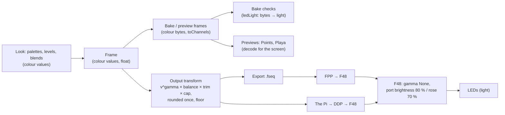

# Light and colour

How a colour in Studio becomes light on the sculpture, and every correction on the way: where it is, why it is
there, and the setting that tunes it. SPEC "Light and output" is the contract; this page is the reasoning.

## Two kinds of number

- **Colour values** (encoded, 0..1). A swatch's own sRGB numbers: `#808080` is 0.5. Every look, pattern, palette,
  level, Amount, fade and blend works in these. They are *perceptual*: 0.5 looks about half as bright as 1.
- **Light** (linear, 0..1 of full). What an LED actually emits: its PWM duty. Twice the number is twice the photons.

An LED's light is not its value. Half the light (0.5) looks much brighter than half (about 0.73 as a value), which
is why a straight value-to-PWM mapping makes every dim look washed out. The bridge between the two is a power
curve, the **gamma**: `light = value ^ gamma`.

## The path

## Every correction

| Where | What | Why | Tune it |
|---|---|---|---|
| Output transform (`core/light.ts` `ledChannels`) | `byte = round(255 · min(1, v^gamma · balance[colour] · trim[LED] · cap))` | Turns perceptual values into the PWM that looks like them. One curve, applied once, in float, rounded once at the end | Light page (Admin › Light): Gamma (default 2.2) |
| Same, `balance` | × each colour's share | Matches the LEDs' white to the eye: trim the colour that runs strong. Never above 100 %: that would only clip | Light page: Red/Green/Blue balance (default 100 %) |
| Same, `floor` | A lit channel never sends less than `floor` | 8 bits run out at the bottom: at gamma 2.2 any value under about 0.06 rounds to 0, so a faint bed vanishes. The floor keeps it glowing (at the cost of the very bottom of a fade looking stepped) | Light page: Floor (default 0, off) |
| Same, `trim` | A group's light × its level, by rig tag | A part that runs bright (denser LEDs, a different strip) can match the rest | Light page: Trims (none by default) |
| Same, `cap` | Light × the Pi's master × blackout × fade, or Export's Brightness | A cap after the curve scales light, so dimming never shifts a hue (as WLED and FPP do). Before the curve it would, and it would also land the dim deep in the crushed bottom | The Pi's master; Export's Brightness |
| The F48 (the controller's own settings) | Port brightness 80 % (ports 5–32), 70 % (the rose, 33–48); gamma None | The electrical and thermal backstop, set on the controller. Its gamma is None so ours is the only curve | On the Falcon only. The Light page records them, and Studio never applies them |
| Bake checks (`src/frames.ts`, `core/flash.ts`) | Each baked byte → its light through the same curve (`ledLight`) | Dark, harsh, flashing and power are about light, not colour values | Follows the Light page; judged at full output (no caps or trims), with the settings the bake ran with |
| The Pi's live flash guard | The same, × the master | Watches what actually goes out | Follows the Pi's light.json |

The F48's caps multiply after all of this: a full white on a port at 80 % is 80 % of the LEDs' rated light. The
Light page shows them so the whole chain is in one place. Never set them in software too, or the sculpture is
dimmed twice.

### The curve in numbers (gamma 2.2, white, no balance)

| Value | 100 % | 75 % | 50 % | 25 % | 10 % | 6 % | 3 % |
|---|---|---|---|---|---|---|---|
| Sends (of 255) | 255 | 135 | 55 | 12 | 2 | 1 | 0 |
| Light | 100 % | 52.9 % | 21.6 % | 4.7 % | 0.8 % | 0.4 % | 0 |

The Light page shows this table live as gamma and the floor change. `test/light.test.js` pins it.

### Why rounding once is not enough at the bottom

The transform is computed in float and rounded once, so it wastes no codes. But a byte is still a byte: below about
0.06 the light is under half a step and rounds to off, whatever order things happen in. Two real fixes exist: the
`floor` (here, now) and temporal dithering on the Pi (alternating neighbouring bytes, not built). Looks should keep
a bed at 0.15 or more.

## Where the settings live

- Studio: `<STUDIO_DATA>/light.json`, edited on the admin **Light** page (`PUT /api/admin/light`). Missing or
  unreadable, every field is its default; a field missing from the file is its default. Export and every new bake
  read it.
- The Pi connects to nothing, so it reads the same record from `pi/light.json`: the Light page's **Download for the
  Pi**, copied over. The host's dry-run Pi (`deploy/host.sh`) reads Studio's own file.
- Not in `rig.json`: that is the installation's map, built from the pixel map, and these are how we drive it.

## The previews

The engine and the bakes stay in colour values, and the screen is an sRGB display, so the previews show what a
camera sees of the LEDs only if they decode the same way. Today they disagree with the LEDs and each other:

- **Points** draws the values as they are, but its sprite peaks at 1.15, so anything over 0.87 shows as one flat
  full colour, and an unlit-LED "ghost" adds blue under every lit one.
- **Playa** decodes to light and drives full output into its tone map's shoulder, so mid-tones show lighter,
  relative to full, than the LEDs give them (0.5 shows about 1.4× too bright).
- The highlight dims (`HI_DIM`, `FOCUS_DIM`) multiply colour values in Points and light in Playa, so the same dim
  looks different in each.

The previews' fix (one decode with this page's gamma, dims applied once before either view, no clip or ghost, and
bloom and exposure as labelled choices) comes next, with before-and-after pictures.
